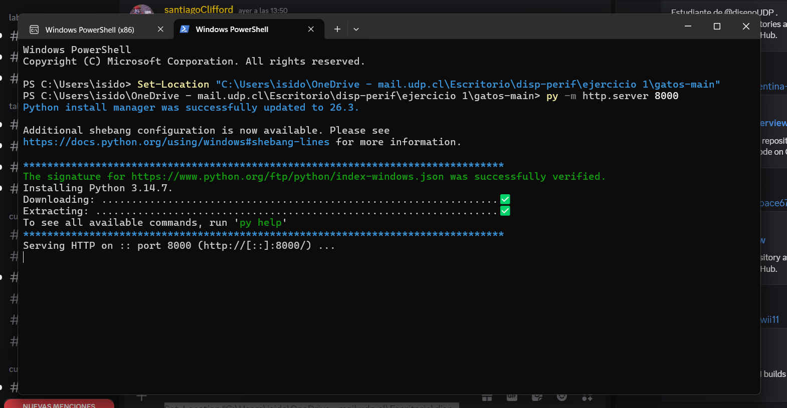

# Clase 02

### computer vision
- dispositivos que permiten observar imagen

### programa de software 
- conjunto de instrucciones donde un computador lo puede ejecutar siguiendo reglas o normas establecidas [dentro de un margen]
- instrucción -- acción a realizar
- dato -- información que el programa utiliza
- condición -- si o no V - F
- secuencia -- orden que ocurren las instrucciones
- repetición -- acción ejecutada muchas veces

### python 
- lenguaje de programación
- fácil lectura
- lenguaje potente, versátil, sintaxis "sencilla"
- intenta emular lenguaje natural en código escritura
- capacidad conectarse a diferentes dispositivos, librerías
- limpiar información
- analizar grandes conjuntos de datos
- calcular estadísticas
- construir gráficos
- identificar patrones
- preparar información para modelos predictivos
- entrenar modelos
- procesar datos
- clasificar imágenes
- analizar textos
- reconocer voces
- construir sistemas predictivos
- experimentar con redes neuronales

### proyecto
python (ordena y clasifica info) -- open cv (captura imágenes, open source computer version) -- media pipe (reconocer elementos naturales)

### librerías 
- NumPy
- pandas
- Matplotlib
- SciPy
- PyTorch
- TensorFlow
- scikit-learn
- MediaPipe
- Transformers
### ejercicio 1 

Poner esto en powershelf

Set-Location "C:\Users\isido\OneDrive - mail.udp.cl\Escritorio\disp-perif\ejercicio 1\gatos-main"

py -m http.server 8000

luego abrir localhost:8000 en navegador

